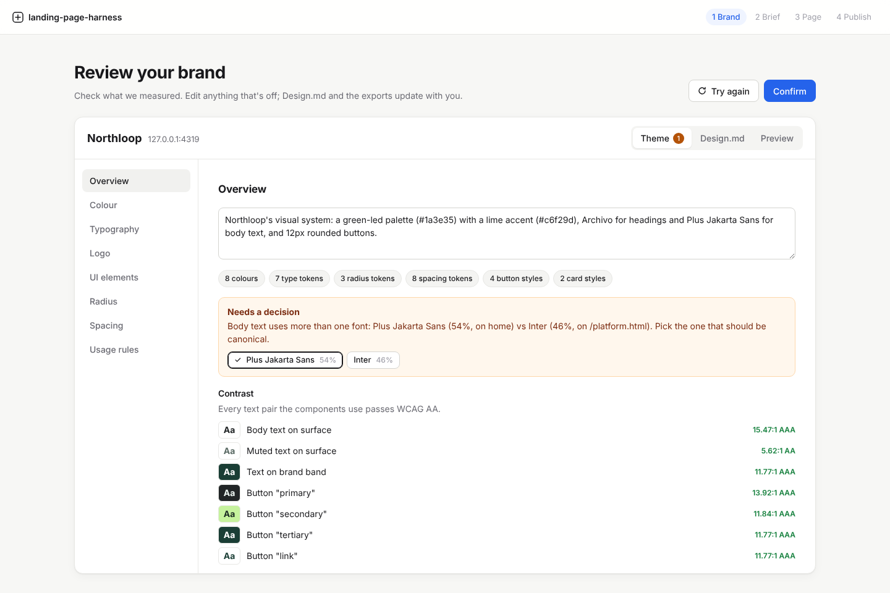

# landing-page-harness

Let non-technical teams launch on-brand, SEO-ready landing pages, with guardrails so nothing ships without passing brand, accessibility, performance and SEO checks.

It works on any website because it reads the CSS a site actually renders, not a specific CMS, and it publishes through pull requests, so it fits whatever stack and review process a company already has.

| Phase | What it does | Status |
|---|---|---|
| 1. Brand | Enter a URL; get a reviewed design system (tokens, Design.md, starter components) | **Built** |
| 2. Brief | Describe a campaign; get an editable marketing brief grounded in the site and your SEO/AEO tools | Planned |
| 3. Page | Generate the landing page from the starter components, one variant per audience | Planned |
| 4. Publish | Brand, accessibility, performance and SEO checks, then a pull request with a preview | Planned |

See [docs/spec.md](docs/spec.md) for the full plan.

## Phase 1: brand import



1. **Sample.** A headless browser opens the home page and the main product page (picked from the navigation, or chosen by the user) at desktop and mobile widths.
2. **Measure.** It reads computed styles for headings, body text, buttons, cards, inputs, section backgrounds, the logo and any `:root` variables, and records where each value came from.
3. **Cluster.** Colours are grouped by role (brand, accent, ink, surface, neutrals) and weighted by area and frequency. Type, buttons, cards, radius and spacing are grouped by repeated values.
4. **Review.** The user checks everything in the Theme tab. Every value shows a confidence level and the page and selector it came from. Conflicts, such as two body fonts across pages, are flagged for a decision instead of being guessed. Contrast is checked against WCAG as you edit.
5. **Confirm.** This writes the brand kit:

| File | For |
|---|---|
| `tokens.css` | CSS custom properties: raw palette, semantic aliases (`--color-brand`, `--font-heading`, `--radius-card`, ...) and per-variant button and card classes |
| `tokens.json` | The same tokens in the [W3C DTCG](https://design-tokens.github.io/community-group/format/) format, for Figma, Style Dictionary and other tools |
| `DESIGN.md` | The brand written for agents: values, usage rules, contrast, provenance |
| `preview.html` | A sample page built from the starter components, to check the tokens at a glance |
| `logo.svg` | The header logo, sanitised |

**One rule throughout:** values are always measured. Names, descriptions and rules can be written later by a model, but a model never sets a colour, size or radius.

### Improvements over the reference demo

- Every token shows its **source and confidence**, so a reviewer knows what to double-check.
- **Conflicts are surfaced**, not hidden. The fixture site's product page uses a different body font on purpose, to show this.
- **Editing a colour updates every component that used it**, along with the summary and rules.
- **Contrast checks** run on every text pair the components will render.
- A **live preview** renders real components with the tokens, rather than static swatches.
- Light logos are flagged when they would vanish on light backgrounds.

## Quick start

```bash
pnpm install
pnpm --filter @lph/extractor exec playwright install chromium

# Terminal 1: a fictional site to import (http://127.0.0.1:4319)
pnpm fixture

# Terminal 2: API on :8787 and the studio on :5173
LPH_ALLOW_PRIVATE_URLS=1 pnpm dev
```

Open http://localhost:5173 and import `http://127.0.0.1:4319/`, or any public site.

From the command line (no UI):

```bash
pnpm extract https://example.com --out brands/example
pnpm extract https://example.com --product https://example.com/platform
```

## For agents

Everything the studio does is a plain HTTP call, described at `GET /api/openapi.json`:

```bash
# Import (blocking) and read the results
curl -X POST 'localhost:8787/api/brands?wait=true' -H 'content-type: application/json' -d '{"url":"https://example.com"}'
curl localhost:8787/api/brands/<id>/design.md
curl localhost:8787/api/brands/<id>/tokens.css
```

An MCP server over the same API is planned (M5), so Claude, Codex, Cursor or any other MCP client can read a brand directly.

## Repository layout

```
apps/
  api/          Hono API: import jobs, edits, conflict resolution, exports
  studio/       React Router + Vite + SCSS Modules review UI
packages/
  extractor/    Playwright sampling (collect.ts runs in the page) and analysis (analyze.ts)
  tokens/       Brand types, colour maths, CSS/DTCG output, contrast, edits
  design-md/    DESIGN.md generator
  ui/           Starter components: framework-agnostic CSS classes plus React wrappers
  kit/          Writes the brand kit and renders preview.html
fixtures/
  northloop/    A fictional B2B site used by the tests
```

## Security notes

- The API drives a real browser to user-supplied URLs, so it refuses private and internal addresses (SSRF), unless `LPH_ALLOW_PRIVATE_URLS=1` is set for local fixtures. Redirects inside the browser are not yet checked; route-level blocking is on the list before any hosted deployment.
- SVG logos are sanitised in the page's own DOM at extraction time (scripts, event handlers, external links and `foreignObject` removed). Design.md is sanitised before rendering, and site-derived strings can't close the preview's `<style>` block.

## Development

```bash
pnpm typecheck
pnpm test        # unit tests plus real-browser extraction against the fixture
```

CI runs typecheck, tests and the studio build on every pull request.
