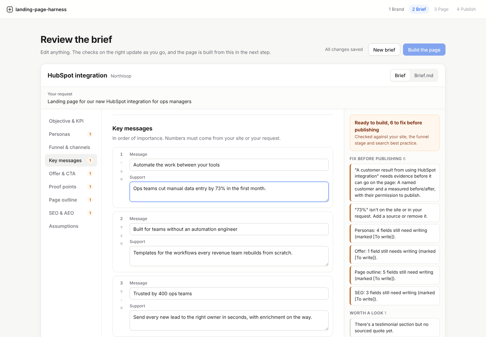
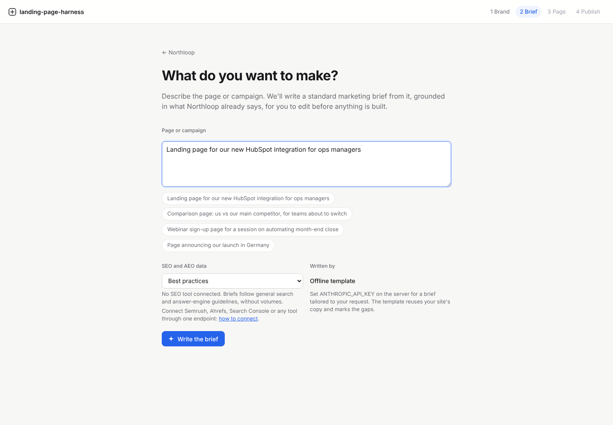
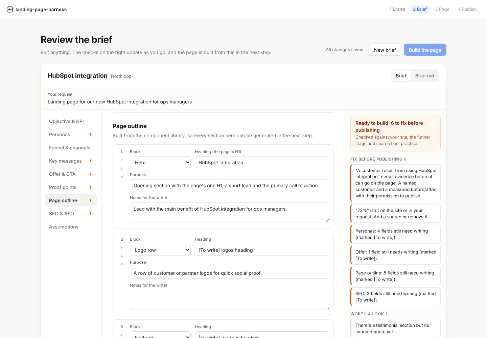
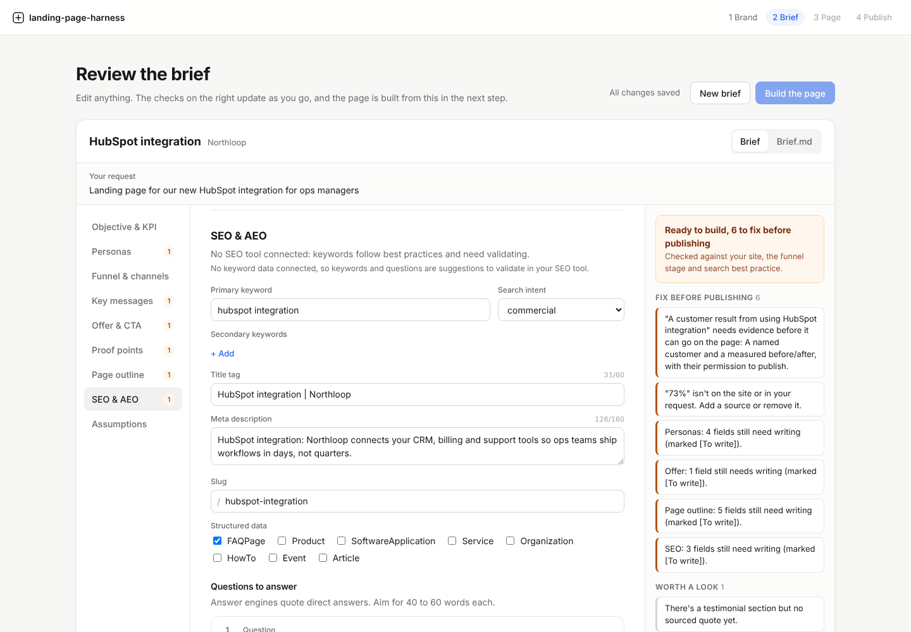
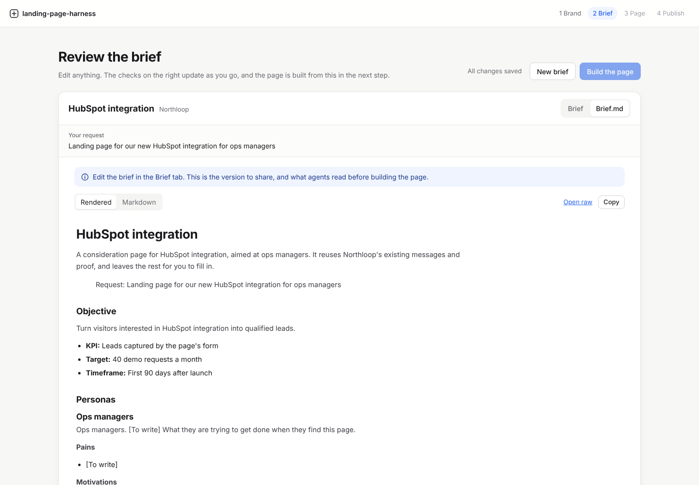

# Softlander

Let non-technical teams launch on-brand, SEO-ready landing pages, with guardrails so nothing ships without passing brand, accessibility, performance and SEO checks.

It works on any website because it reads the CSS a site actually renders, not a specific CMS, and it publishes through pull requests, so it fits whatever stack and review process a company already has.

| Phase | What it does | Status |
|---|---|---|
| 1. Brand | Enter a URL; get a reviewed design system (tokens, Design.md, starter components) | **Built** |
| 2. Brief | Describe a campaign; get an editable marketing brief grounded in the site and your SEO/AEO tools | **Built** |
| 3. Page | Generate the landing page from the starter components, one version per persona, with a lead form wired to HubSpot or a webhook | **Built** |
| 4. Publish | Brand, accessibility, performance and SEO checks, then a pull request with a preview; copy edits merge themselves, the rest goes to a reviewer | **Built** |

See [docs/spec.md](docs/spec.md) for the full plan.

**Try it:** the [live demo](https://tywiththewifi.github.io/landing-page-harness/) runs the studio in your browser. Import any public site, or Northloop, a fictional sample. A small [import service](docs/import-service.md) opens the site in a headless browser and hands the measurements back, keeping nothing; everything else (conflicts, contrast, Design.md, the preview, briefs, pages, the publish checks and the Cloudflare Pages download) runs in the browser on the same code as the app, with briefs and page copy from the offline writer.

## Phase 1: brand import


1. **Sample.** A headless browser opens the home page and the main product page (picked from the navigation, or chosen by the user) at desktop and mobile widths.
2. **Measure.** It reads computed styles for headings, body text, buttons, cards, inputs, section backgrounds, the logo (inline SVG, an image, or one drawn with a CSS background or mask) and any `:root` variables, plus the site's strip of customer logos for logo rows, and records where each value came from.
3. **Cluster.** Colours are grouped by role (brand, accent, ink, surface, neutrals) and weighted by area and frequency. Type, buttons, cards, radius and spacing are grouped by repeated values.
4. **Review.** The user checks everything in the Theme tab. Every value shows a confidence level and the page and selector it came from. Conflicts, such as two body fonts across pages, are flagged for a decision instead of being guessed. Contrast is checked against WCAG as you edit.
5. **Confirm.** This writes the brand kit:

| File | For |
|---|---|
| `tokens.css` | CSS custom properties: raw palette, semantic aliases (`--color-brand`, `--font-heading`, `--radius-card`, ...) and per-variant button and card classes |
| `tokens.json` | The same tokens in the [W3C DTCG](https://design-tokens.github.io/community-group/format/) format, for Figma, Style Dictionary and other tools |
| `DESIGN.md` | The brand written for agents: values, usage rules, contrast, provenance |
| `preview.html` | A sample page built from the starter components, to check the tokens at a glance |
| `logo.svg` | The header logo, sanitised |

**One rule throughout:** values are always measured. Names, descriptions and rules can be written later by a model, but a model never sets a colour, size or radius.

### Improvements over the reference demo

- Every token shows its **source and confidence**, so a reviewer knows what to double-check.
- **Conflicts are surfaced**, not hidden. The fixture site's product page uses a different body font on purpose, to show this.
- **Editing a colour updates every component that used it**, along with the summary and rules.
- **Contrast checks** run on every text pair the components will render.
- A **live preview** renders real components with the tokens, rather than static swatches.
- Light logos are flagged when they would vanish on light backgrounds.

## Phase 2: brief



1. **Prompt.** The marketer describes the page or campaign: "Landing page for our new HubSpot integration for ops managers".
2. **Research.** Keyword and question data comes from whichever SEO/AEO tool is connected ([how to connect one](docs/seo-providers.md)). With none connected, the brief follows search and answer-engine best practice and says the keywords need validating. If the site has its own MCP server, its read-only tools are asked about the topic too, so plans, prices and help articles can back the brief ([site data](docs/site-data.md)).
3. **Write.** Claude writes the standard brief: objective and KPI, personas, funnel stage, channels, key messages, offer and CTA, proof points, page outline, and SEO/AEO targets (keyword, title, meta description, slug, questions with direct answers, structured data). Without an API key, an offline template writes the structure from the site's own copy and marks the gaps.
4. **Edit.** Every field is editable. The outline can only use blocks the component library has, so whatever is planned can be built in phase 3. Each persona becomes its own page variant with its own URL.
5. **Check.** A consistency check runs as you type, with no model involved:
   - Every number in the brief must appear on the site, in the site's MCP answers or in the request. Proof points carry their evidence, and "needs evidence" items block publishing.
   - The call to action has to fit the funnel stage, and a CTA that asks for details needs a form.
   - Title and meta lengths, keyword placement, slug, FAQ questions and FAQPage markup are checked against search and answer-engine practice.
   - Headings are compared with the casing the site uses.

**The same rule as phase 1:** the model writes, but it doesn't invent. Brand imports now capture each page's headings, copy and button labels, and the brief is grounded in them.

Ads are out of scope for now: channels are owned and earned only.

|  |  |
|---|---|
|  |  |

## Phase 3: page


1. **Build.** Each section of the brief's outline becomes a block from the component library: hero, logo row, features, how it works, stats, testimonial, comparison, FAQ, lead form or closing CTA. Building is refused while the brief has must-fix issues.
2. **Write.** Claude writes the copy into that structure under the brief's grounding rules; anything it can't source is left as `[To write]` for a person. Without an API key, an offline writer fills the blocks from the brief and marks the rest.
3. **Edit.** A constrained editor: copy, plus the few props the components expose (a section's background, the brand's card styles, the form's fields). No free layout. Buttons are picked per band from the styles the site uses on that background.
4. **Personalise.** Each persona gets a version on its own URL (`/{slug}/{persona}`) that overrides copy only, so a fix to the general page reaches every version. The **Versions** tab lays them out as a table: URL, H1, subheadline, CTA and which fields are personalised.
5. **Capture leads.** The form's fields are named after HubSpot contact properties. Leads go to a HubSpot form (Forms API v3), to a signed webhook, or stay in the studio in test mode, with the page, version, UTMs and HubSpot tracking cookie attached.
6. **Check.** The page checks run as you type: placeholders left, missing text, broken anchors and links, the form's fields and connector, version URLs, unsourced numbers and quotes, and title and meta lengths. Errors block publishing in phase 4.

The preview renders exactly the HTML that gets published: one H1, canonical and Open Graph tags, and `WebPage`, `Organization` and `FAQPage` JSON-LD. See [docs/pages.md](docs/pages.md) for the checks, the version model, the webhook payload and signature, and the API.

|  |  |
|---|---|
|  | |

## Phase 4: publish


1. **Check.** Every version is rendered as it will go live and checked: the page's content rules, brand (nothing styled outside the tokens, the brand's fonts load), SEO and answer engines, accessibility with axe (WCAG 2.2 AA, at phone and desktop widths) and a performance budget measured in Chromium at phone size with a slowed CPU. Errors block publishing and link back to the field in the editor.
2. **Pull request.** The page goes into the company's own site repo as one commit on its own branch: each version's HTML, the page's source, its security headers and the form endpoint. The description has a preview link per version, the check results and performance per version.
3. **Risk.** A copy change to a page that's already live, with no new warnings, is labelled `lph:content` and merges itself once the repo's checks pass. A new page, a new section, a new link target, new brand tokens or a new warning is labelled `lph:needs-review` and the reviewers are asked. A warning a reviewer accepted isn't asked about again, unless its text changes.
4. **CI decides again.** The site repo's workflow ([template](templates/site)) runs the checks on the committed HTML and works out the risk from the diff itself, comparing the HTML with its words taken out, so neither a label added by hand nor an HTML file edited by hand can skip review.
5. **No repo?** The same files download as a Cloudflare Pages project, with the form endpoint as a Pages Function.

See [docs/publish.md](docs/publish.md) for the checks, the budget, the risk rules and setting up the site repo.

|  |  |
|---|---|

## Quick start

```bash
pnpm install
pnpm --filter @lph/extractor exec playwright install chromium

# Terminal 1: a fictional site to import (http://127.0.0.1:4319)
pnpm fixture

# Terminal 2: API on :8787 and the studio on :5173
LPH_ALLOW_PRIVATE_URLS=1 pnpm dev
```

Open http://localhost:5173 and import `http://127.0.0.1:4319/`, or any public site. Confirm the brand, then choose **Plan a page** to write a brief, **Build the page** to make it, and **Publish** to check it and open a pull request (or download it for Cloudflare Pages).

Set `ANTHROPIC_API_KEY` for Claude-written briefs and page copy (see [.env.example](.env.example) for the other settings).

From the command line (no UI):

```bash
pnpm try stripe.com                      # every phase, report and outputs in runs/
pnpm try webflow.com qonto.com --prompt "Landing page for our accounting integration for finance teams"
pnpm extract https://example.com --out brands/example   # the brand kit only
pnpm extract https://example.com --product https://example.com/platform
```

`pnpm try` imports the brand, writes the brief, builds the page and runs the publish checks, then writes `report.md` and each step's output to a folder. See [docs/mcp.md](docs/mcp.md), which also lists what runs against a dozen live sites found.

## For agents

Everything the studio does is a plain HTTP call, described at `GET /api/openapi.json`:

```bash
# Import (blocking) and read the results
curl -X POST 'localhost:8787/api/brands?wait=true' -H 'content-type: application/json' -d '{"url":"https://example.com"}'
curl localhost:8787/api/brands/<id>/design.md
curl localhost:8787/api/brands/<id>/tokens.css

# Write a brief (blocking), check it, and read it as Markdown
curl -X POST 'localhost:8787/api/brands/<id>/briefs?wait=true' -H 'content-type: application/json' -d '{"prompt":"Landing page for our HubSpot integration for ops managers"}'
curl localhost:8787/api/briefs/<briefId>/check
curl localhost:8787/api/briefs/<briefId>/brief.md

# Build the page (blocking), check it, and render a persona's version
curl -X POST 'localhost:8787/api/briefs/<briefId>/pages?wait=true'
curl localhost:8787/api/pages/<pageId>/check
curl 'localhost:8787/api/pages/<pageId>/page.html?version=<persona>'

# Run the publish gate (blocking), see what publishing would do, then open the pull request
curl -X POST 'localhost:8787/api/pages/<pageId>/gate?wait=true'
curl localhost:8787/api/pages/<pageId>/publish
curl -X POST localhost:8787/api/pages/<pageId>/publish
curl -o site.zip localhost:8787/api/pages/<pageId>/site.zip   # or as a Cloudflare Pages project
```

### MCP server

The same calls as MCP tools, for Claude Desktop, Claude Code, Cursor or any MCP client. `launch_from_url` runs a site through every phase in one call; the other tools go step by step (`import_brand`, `write_brief`, `update_brief`, `build_page`, `update_page`, `run_checks`, `publish_plan`, `publish_page`), and each brand's DESIGN.md is a resource. Without `LPH_API_URL` it runs the API in its own process.

```bash
claude mcp add softlander -- pnpm --silent --dir /path/to/landing-page-harness mcp
```

See [docs/mcp.md](docs/mcp.md) for Claude Desktop and the tool list.

## Repository layout

```
apps/
  api/          Hono API: import, brief and page jobs, edits, conflict resolution, checks,
                exports, the form endpoint, the publish gate and publishing
                (public.ts: the demo's stateless import service)
  studio/       React Router + Vite + SCSS Modules review UI (src/demo: the serverless demo build)
  mcp/          The MCP server over the API, and `pnpm try`: any URL through every phase
packages/
  extractor/    Playwright sampling (collect.ts runs in the page) and analysis (analyze.ts)
  brief/        Brief schema, Claude and offline writers, SEO/AEO providers, consistency check
  tokens/       Brand types, colour maths, CSS/DTCG output, contrast, edits
  design-md/    DESIGN.md generator
  page/         Page schema, persona versions, Claude and offline writers, checks, renderer
  forms/        Lead form fields, submission parsing, HubSpot and webhook delivery (Web APIs only)
  checks/       The publish gate: content, brand, SEO/AEO, axe and performance, in Node or the browser
  publisher/    Site files, risk, pull requests through GitHub's API, the Cloudflare Pages bundle,
                and lph-site, the CLI the site repo's CI runs
  ui/           Starter components and page blocks: framework-agnostic CSS classes plus React wrappers
  kit/          Writes the brand kit and renders preview.html
fixtures/
  northloop/    A fictional B2B site used by the tests
templates/
  site/         The company's site repo: lph.json, the landing pages workflow, wrangler.toml
```

## Security notes

- The API drives a real browser to user-supplied URLs, so it refuses private and internal addresses (SSRF), unless `LPH_ALLOW_PRIVATE_URLS=1` is set for local fixtures. The same rule holds inside the browser: every request the page makes is checked before it's sent, and redirects are caught from the address that answered, so a page can't redirect or load its way inside. The site's MCP server is checked the same way, and redirects from it are refused.
- Site copy and SEO tool output reach the model as data in tagged blocks, separate from its instructions, and the brief comes back through a strict schema. The SEO endpoint is set by the operator, not by users.
- The form endpoint keeps only the fields the form asks for, validates them, and drops honeypot posts silently. Webhook URLs get the same SSRF rule as imports, redirects aren't followed, and posts can be signed (HMAC-SHA256 with a timestamp). Every lead is stored with its delivery result, so a failed delivery isn't lost. Page links are limited to sections, site paths, https, `mailto:` and `tel:`.
- Published pages get a Content Security Policy in `_headers`: nothing loads or runs but the page's own inline script (allowed by its hash), and the form can post only to its endpoint. The GitHub token needs only the site repo's contents and pull requests, and stays on the server. The site repo's CI decides what merges by itself from the diff, not from the label. The gate's browser refuses private addresses like the importer's.
- SVG logos, the header's and customers', are sanitised in the page's own DOM at extraction time (scripts, event handlers, external links, link-setting animations and `foreignObject` removed). A brand edit can rename or remove a customer logo but not change its markup. Design.md is sanitised before rendering, and site-derived strings can't close the preview's `<style>` block or a page's JSON-LD.

## Development

```bash
pnpm typecheck
pnpm test        # unit tests plus real-browser extraction against the fixture
pnpm --filter @lph/studio build:demo   # the static demo, in apps/studio/dist-demo
```

CI runs typecheck, tests and both studio builds on every pull request. Pushes to `main` publish the demo to GitHub Pages.
