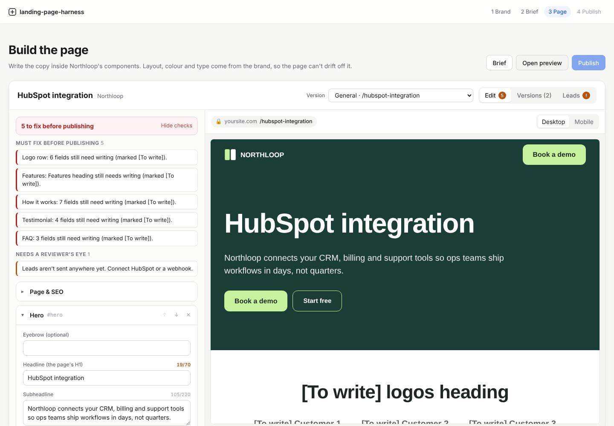
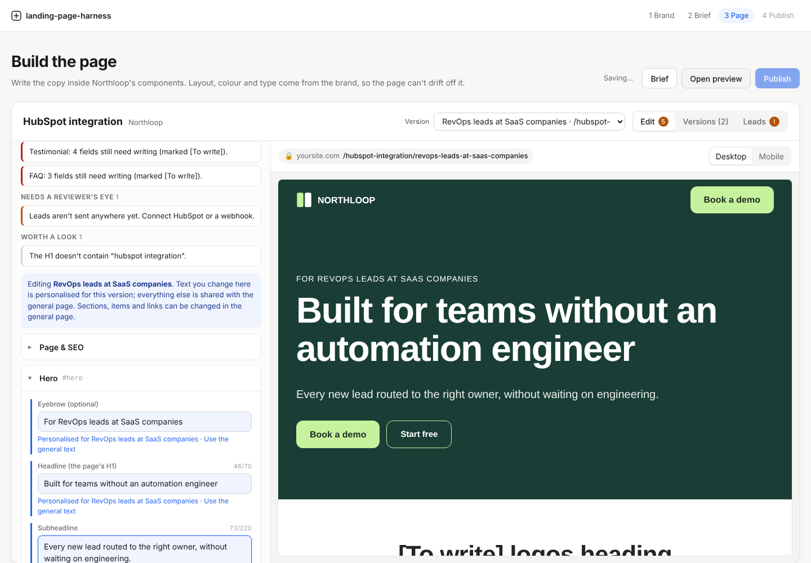
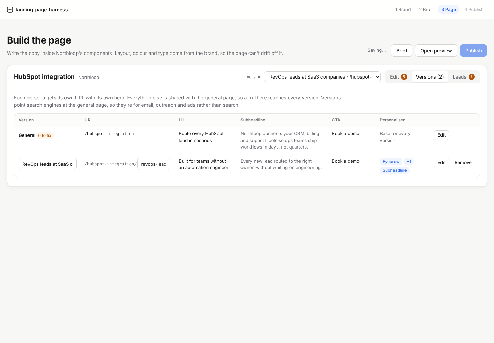
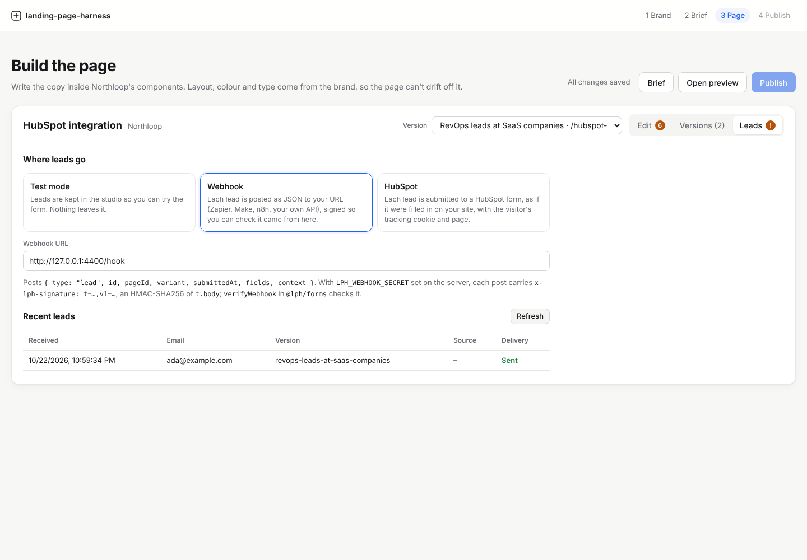

# Pages (phase 3)

A reviewed brief becomes a landing page built only from the component library, with a version for each persona and a lead form that posts to HubSpot or a webhook.



## How a page is built

1. **Build.** On the brief, choose **Build the page**. It's refused while the brief has must-fix issues. Each section of the brief's outline becomes a block: hero, logo row, features, how it works, stats, testimonial, comparison, FAQ, lead form or closing CTA.
2. **Write.** With an API key, Claude writes the copy into that structure: it can't add a section the library doesn't have, drop the form or change where buttons point. It follows the brief's grounding rules: numbers, customers and quotes come from the site, its MCP data, the request or the brief's sourced proof. Anything else is left as `[To write]` for a person. Without a key, an offline writer fills the blocks from the brief's messages, proof and questions and marks the rest.
3. **Edit.** The editor changes copy and the few props the components expose: a section's background (plain, subtle or brand colour), the card style (from the brand's measured card styles) and the form's fields. There is no free layout. Spacing, colour, type and button styles come from the brand's tokens, and buttons are picked per band from the styles the site uses on that background, so nothing can drift off-brand.
4. **Check.** The page checks run as you type, in the API (`GET /api/pages/:id/check`) and again in the publish gate. **Errors** block publishing; **warnings** need a reviewer's eye.

| Check | Severity |
|---|---|
| Opens with the hero, one hero (one H1) | error |
| `[To write]` left anywhere, in any version | error |
| Required text missing (H1, buttons, FAQ answers, stat values…) | error |
| A button with no link, an unsafe link, or an anchor to a section that doesn't exist | error |
| The form has no email or phone field, asks for a field twice, or has an unlabelled field | error |
| HubSpot connector without a portal ID or form GUID; webhook without an https URL | error |
| A version's URL isn't a clean slug, or is taken by another version | error |
| A number that isn't on the site, in its data, in the request or in the brief's sourced proof | warning |
| A testimonial quote that isn't in those sources (publish only if real and permitted) | warning |
| Leads aren't sent anywhere yet | warning |
| Title 30–60 and meta description 120–160 characters, keyword in the title | warning |
| A version that's identical to the general page | warning |
| H1 over 70 characters, button labels over five words | warning |
| A card style the brand doesn't have; no button style that stands out on a band | warning |
| Keyword in the H1, FAQ answers under 25 words, heading casing vs the site, personas without a version | info |

## Persona versions



Each persona in the brief gets a version on its own URL: the general page lives at `/{slug}` and each version at `/{slug}/{persona}`. A version shares every block with the general page and overrides copy only. Pick a version in the editor and every text field writes an override for it, marked as personalised, with a way back to the general text. Sections, items, links and form fields can only be changed in the general page, so a fix there reaches every version.

The offline writer personalises each version's hero: the eyebrow names who it's for, and the H1 and subheadline lead with the key message closest to the persona's motivations and pains. Claude rewrites the hero for each persona under the same grounding rules.

Overrides are stored as `"<block id>.<path>"` keys, for example `hero.heading`, `features.items.0.title` or `seo.title`. Overrides that point at a removed block or repeat the general text are dropped on save.

Versions point search engines at the general page (`rel="canonical"`), because they're for targeted traffic: email, outreach and ads. The general page is the one that ranks.

The **Versions** tab shows them side by side:



| Column | What it shows |
|---|---|
| Version | The persona's name (editable) |
| URL | `/slug/persona` (the persona part is editable) |
| H1, Subheadline, CTA | The hero as that version shows it |
| Personalised | Which fields the version overrides |

## The rendered page

`renderPage(page, brand, uiCss, options)` in `@lph/page` returns a standalone HTML document. It runs in the browser (the editor's live preview) and in Node (the API, and the publisher in phase 4), so the preview is exactly what gets published.

- The brand's tokens and the component CSS inline, plus the brand's web fonts.
- One H1, landmarks (`header`, `main`, `footer`), a skip-free single column that works at 390px.
- `<title>`, meta description, canonical, Open Graph and Twitter tags.
- JSON-LD: `WebPage`, `Organization` and, when there's an FAQ, `FAQPage` built from the answers on the page.
- `noindex` on every preview.
- Copy is escaped by React; links are limited to sections, site paths, https, `mailto:` and `tel:`; nothing site-derived can close the `<style>` or JSON-LD `<script>` blocks.

`GET /api/pages/:id/page.html?version=<slug>` serves it from the API.

## Lead forms

The form's fields are named after HubSpot's default contact properties (`email`, `firstname`, `lastname`, `company`, `jobtitle`, `phone`, `website`, `message`), so the same submission maps onto HubSpot with no setup and a webhook gets the same names.

The page carries one small inline script. It checks the fields in the browser, adds where the lead came from (the page URL with its UTMs, the version, HubSpot's `hubspotutk` cookie, the referrer) and posts it urlencoded, like a plain form, so a cross-origin endpoint needs no CORS preflight. A hidden honeypot field catches bots: they're told it worked and nothing is kept. Without scripts the form still posts.

Choose where leads go in the **Leads** tab:



| Connector | What happens |
|---|---|
| Test mode | Leads are kept in the studio (`data/submissions`) so you can try the form. |
| HubSpot | Each lead is submitted to a HubSpot form through the [Forms API v3](https://developers.hubspot.com/docs/api-reference/legacy/marketing/forms/v3-legacy/submit-data-authenticated) (`submissions/v3/integration/submit/{portalId}/{formGuid}`), with the page URL, page name, tracking cookie and visitor IP as context. With `HUBSPOT_ACCESS_TOKEN` (a private app token) on the server, the authenticated `secure/submit` endpoint is used, with higher rate limits. Add the same fields to the HubSpot form and turn its CAPTCHA off: HubSpot refuses API submissions to forms with CAPTCHA. |
| Webhook | Each lead is posted as JSON to your URL (Zapier, Make, n8n, your own API). |

A webhook receives:

```json
{
  "type": "lead",
  "id": "4b0c…",
  "pageId": "e703…",
  "variant": "revops-leads",
  "submittedAt": "2026-10-22T08:00:00.000Z",
  "fields": { "email": "ada@example.com", "firstname": "Ada" },
  "context": { "pageUri": "https://www.example.com/hubspot?utm_source=newsletter", "pageName": "…", "variant": "revops-leads", "utm": { "utm_source": "newsletter" } }
}
```

With `LPH_WEBHOOK_SECRET` set, each post carries `x-lph-signature: t=<unix seconds>,v1=<hex>`, an HMAC-SHA256 of `"<t>.<body>"`. Check it with `verifyWebhook` from `@lph/forms`, which also rejects signatures older than five minutes:

```ts
import { verifyWebhook } from "@lph/forms";
const ok = await verifyWebhook(rawBody, req.headers["x-lph-signature"], process.env.LPH_WEBHOOK_SECRET);
```

Webhook URLs get the same SSRF rule as imports: private and internal addresses are refused (unless `LPH_ALLOW_PRIVATE_URLS=1`), and redirects aren't followed. Every lead is stored with what happened when it was sent on, so a failed delivery isn't lost; the visitor is told to try again. `@lph/forms` uses only Web APIs, so the same code runs in a Cloudflare Pages Function in phase 4.

## API

```bash
# Build the page from a brief (blocking), then read, check and render it
curl -X POST 'localhost:8787/api/briefs/<briefId>/pages?wait=true'
curl localhost:8787/api/pages/<pageId>
curl localhost:8787/api/pages/<pageId>/check
curl 'localhost:8787/api/pages/<pageId>/page.html?version=<persona>'

# Save edits (blocks must be library sections; versions override copy only)
curl -X PUT localhost:8787/api/pages/<pageId> -H 'content-type: application/json' -d @page.json

# The form endpoint, and the leads it received
curl -X POST localhost:8787/api/forms/<pageId> -d 'email=ada@example.com&firstname=Ada'
curl localhost:8787/api/pages/<pageId>/submissions
```
