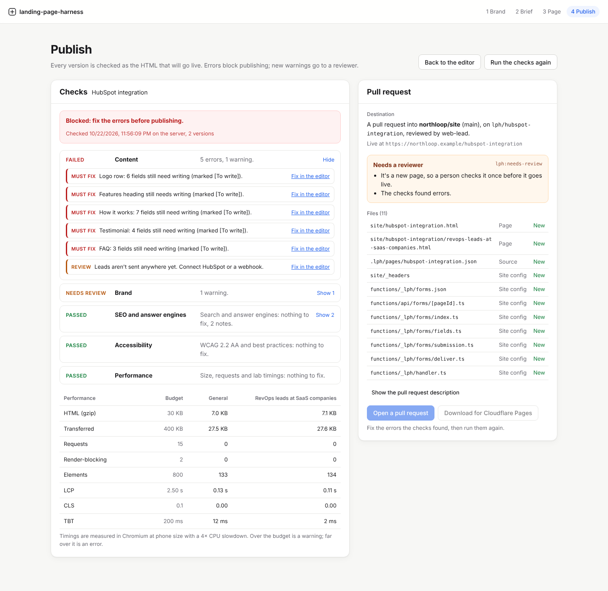
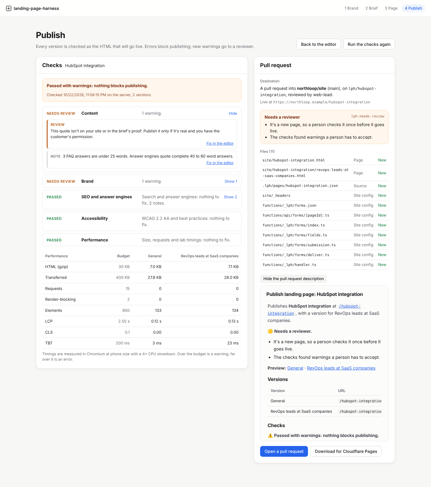
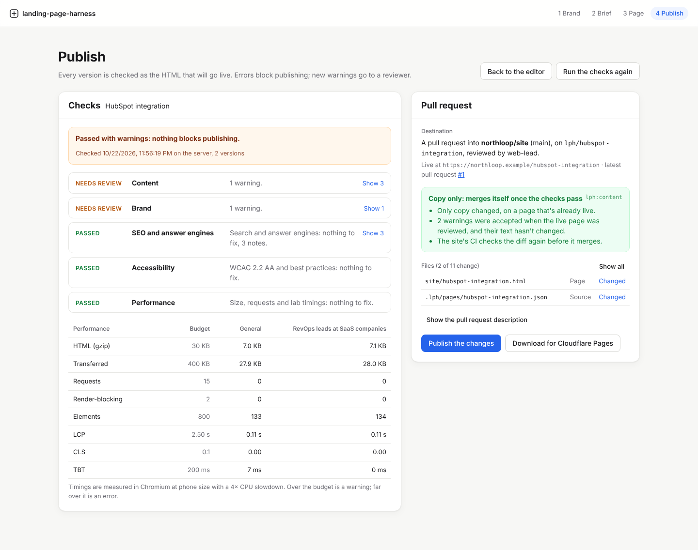

# Publishing (phase 4)

A page goes live through the company's own site repo. The studio checks every version as the HTML that will be published, then opens a pull request with a preview link for each version. A copy change to a page that's already live merges itself once the repo's checks pass; anything else waits for a reviewer. With no site repo, the same files download as a folder for Cloudflare Pages.



## The publish gate

Choose **Publish** in the page editor. The checks run on their own when there's no report for the page as it is now, and again with **Run the checks again**. Agents use `POST /api/pages/:id/gate?wait=true`.

Each version is rendered exactly as it will be published, with the live site's canonical URLs and the form posting to its real endpoint, then checked. The same issue on every version is reported once; an issue on some versions names their URLs.

| Verdict | Means |
|---|---|
| **Blocked** | At least one error. Publishing and the download are disabled until it's fixed and the checks run again. |
| **Passed with warnings** | Nothing blocks publishing. A reviewer looks at each warning once (see [Risk](#risk-copy-only-or-needs-a-reviewer)). |
| **Ready** | Every check passed. |

Errors link back to the field in the editor (**Fix in the editor**), in the right version.

| Check | What it looks at | Errors | Warnings |
|---|---|---|---|
| **Content** | The page checks from [Pages](pages.md#how-a-page-is-built): placeholders, required text, links, the form and where its leads go, sourced numbers and quotes, lengths | `[To write]` left, missing text, broken links, an unusable form | Unsourced numbers or quotes, leads going nowhere, long H1s and buttons |
| **Brand** | The rendered HTML against the brand: nothing styled outside the tokens | Inline styles, a `--color-*` or `--font-*` token that isn't defined, a button or card style the CSS doesn't have | A token the brand doesn't set, so a component uses its built-in default; a brand font that isn't loaded (visitors see a fallback) |
| **SEO and answer engines** | `lang`, viewport, title, meta description, one H1, robots, canonical, Open Graph, JSON-LD, FAQ markup, the brief's questions and keyword | No `lang`, viewport, title, description or H1; `noindex`; no absolute https canonical; JSON-LD that doesn't parse; FAQ markup for questions that aren't on the page | A question the brief plans to answer that the page doesn't ask, missing `og:*` tags or WebPage data, a general page whose canonical points elsewhere |
| **Accessibility** | axe-core 4.14 (WCAG 2.0, 2.1 and 2.2 A and AA, plus best practices), every version at phone width and the general page at desktop width | Serious or critical WCAG failures (contrast, missing names, image alt…) | Other WCAG failures, serious best-practice issues |
| **Performance** | Size and requests from the HTML, and lab timings in Chromium | Far over the budget | Over the budget |

Notes (`info`) never block or need a reviewer: a missing share image, the keyword missing from the first 100 words, a short page, items axe couldn't decide.

### Performance budget

| Measure | Warning over | Error over |
|---|---|---|
| HTML, gzipped | 30 KB | 100 KB |
| Transferred in total | 400 KB | 1000 KB |
| Requests | 15 | 40 |
| Render-blocking stylesheets and scripts | 2 | 5 |
| Elements | 800 | 1400 |
| Largest Contentful Paint | 2.5 s | 4 s |
| Cumulative Layout Shift | 0.1 | 0.25 |
| Total Blocking Time | 200 ms | 600 ms |

The lab run opens each version at 390 × 844 with the CPU slowed 4×, served from memory so the network isn't measured. What the page loads itself (fonts, images) is fetched for real, but never from a private or local address: the checks can't be used to reach the server's network. In the site repo's CI, `--offline` skips outside requests altogether.

### Where the checks run

| | Server (API) | Studio demo | Site repo CI (`lph-site check`) |
|---|---|---|---|
| HTML checks | linkedom | DOMParser | linkedom |
| Accessibility | axe in Chromium | axe in a sandboxed, hidden frame | axe in Chromium |
| Lab timings | Yes | No (sizes only) | Yes |
| Content check | Yes | Yes | No: it needs the brief and brand, so CI trusts the studio's result recorded with the page and runs everything else again |

A pull request needs a report from the server for the page as it is now. The report is kept in `data/gates/` and summarised in the page's source in the repo.

## Publishing as a pull request



The **Pull request** panel shows what publishing would do before anything is written: the destination, the risk and why, every file with whether it's new or changed, and the pull request's description. **Open a pull request** writes one commit to the page's branch, `lph/<slug>`, and opens the pull request, or updates it if it's open. Each publish replaces the branch's commit, the way Dependabot does. If someone else pushed to the branch since, nothing is overwritten and the studio says so.

| File | What it is |
|---|---|
| `site/<slug>.html` | The general page |
| `site/<slug>/<version>.html` | Each persona's version |
| `.lph/pages/<slug>.json` | The page's source: the page, hashes of the tokens and components that built it, the brief's search targets, and what the checks found. CI reads it; it's never served. |
| `site/_headers` | This page's block of security headers (other pages' blocks are kept) |
| `functions/api/forms/[pageId].ts`, `functions/_lph/` | The form endpoint as a Cloudflare Pages Function, and where each page's leads go (`forms.json`) |

A version removed in the studio has its HTML file deleted in the same commit.

The description lists the previews (one link per version), the versions with their H1 and button, the check results with performance per version, and the files. Low-risk pull requests are labelled `lph:content`; everything else `lph:needs-review`, with the configured reviewers asked to review.

### Risk: copy only or needs a reviewer



A publish is **copy only** when all of these hold:

- The page is already live (its source is on the base branch).
- Its structure is the same: sections, the items in each, backgrounds and card styles, where buttons link, the form's fields and where its leads go, its URL and its versions' URLs.
- The brand's tokens and the component library are the ones it was last published with.
- No shared file changes (`_headers`, the form endpoint, anything outside the pages).
- The HTML changed in its words only (see below).
- No errors, and no warnings a reviewer hasn't already accepted.

Anything else needs a reviewer, and the pull request says why: a new page, a section added or reordered, a button pointing somewhere new, leads going to a new place, new brand tokens, a new warning.

**Warnings are accepted once.** Merging a pull request accepts the warnings it showed: they're recorded in the page's source. A later copy change with the same warnings is still copy only, unless a warning is about a field whose text changed. A new testimonial quote is checked by a person again, even though the old one was accepted.

**The site's CI decides again.** `lph-site check` works out the risk from the diff itself, so adding the `lph:content` label by hand doesn't skip review. It also compares each page's HTML before and after with its words taken out (every tag, attribute, script and style). A link, script, class or element added to the HTML by hand shows up there, even when the page's source only has copy changes.

## Setting up the site repo

1. **Start from the template.** Copy [`templates/site`](../templates/site) into the repo: `lph.json`, the workflow in `.github/workflows/landing-pages.yml`, `wrangler.toml` and the `site/` folder. See its [README](../templates/site/README.md).
2. **Describe the layout in `lph.json`.**

   | Field | Default | What it is |
   |---|---|---|
   | `origin` | The brand's site | The live site, e.g. `https://www.example.com`. Canonicals and Open Graph URLs use it. |
   | `publicDir` | `site` | The folder served at the site's root (Cloudflare Pages' output directory, Astro's `public/`). `""` for the repo root. |
   | `sourceDir` | `.lph/pages` | Where page sources go. Never served. |
   | `functionsDir` | `functions` | The Pages Functions folder for the form endpoint. `null` when forms post to the studio's API. |
   | `formEndpoint` | `site` | `site` for the function on the site itself, or the studio API's origin. |

3. **Create a token** for the studio: a fine-grained personal access token (or a GitHub App) with access to this repo only, and these permissions: **Contents** read and write, **Pull requests** read and write. Nothing else.
4. **Configure the studio's server.**

   | Variable | Example | |
   |---|---|---|
   | `LPH_GITHUB_REPO` | `acme/www` | The site repo. Publishing as pull requests is on when this and the token are set. |
   | `LPH_GITHUB_TOKEN` | | The token from step 3. |
   | `LPH_GITHUB_BASE` | `main` | The branch pull requests go into. |
   | `LPH_GITHUB_REVIEWERS` | `ana,acme/web` | Users, or `org/team`, asked to review pull requests that need it. |
   | `LPH_GITHUB_API_URL` | `https://github.example.com/api/v3` | GitHub Enterprise Server only. |
   | `LPH_PREVIEW_URL` | `https://{branch}.acme-www.pages.dev` | Where the host previews a branch. `{branch}` becomes Cloudflare's branch alias. |
   | `LPH_SITE_ORIGIN` | `https://www.acme.com` | Overrides `origin` from `lph.json`. |
   | `LPH_FORM_ENDPOINT` | `https://studio.acme.com` | Overrides `formEndpoint`: forms post to the studio's API. |

5. **Repo settings.** Create the labels `lph:content` and `lph:needs-review`. Turn on **Allow auto-merge**. Add a branch rule for the default branch that requires the **check** status. If the rule also requires an approval, copy-only pull requests wait for one click from a reviewer instead of merging themselves: the workflow merges, but never approves.
6. **Previews.** Connect the repo to Cloudflare Pages (or Netlify, or Vercel) so every branch gets a preview deployment, and set `LPH_PREVIEW_URL` to match. Merges by the workflow use the repo's `GITHUB_TOKEN`, which doesn't start other workflows; a host's Git integration deploys them as usual.

The workflow checks out the harness to run the checks. Pin its `ref` to a commit you've reviewed.

### The CLI

```bash
pnpm site check --repo ../www --base origin/main            # the gate on every changed page, and the risk
pnpm site check --repo ../www --base origin/main --offline  # without outside requests
pnpm site classify --repo ../www --base origin/main         # the risk alone, no browser
```

`check` writes `risk=content|review` and `verdict=ready|review|blocked` to `$GITHUB_OUTPUT`, the report to the job summary, and exits 1 when a page is blocked.

## Without a site repo: Cloudflare Pages

**Download for Cloudflare Pages** (or `GET /api/pages/:id/site.zip`) gives the same files as a ready-to-deploy project, once the checks pass without errors:

```text
site/<slug>.html, site/<slug>/<version>.html, site/_headers
functions/api/forms/[pageId].ts, functions/_lph/…
.lph/pages/<slug>.json, lph.json, wrangler.toml, README.md
```

```bash
npx wrangler pages project create <project> --production-branch main   # once
npx wrangler pages deploy
npx wrangler pages secret put HUBSPOT_ACCESS_TOKEN   # optional: HubSpot private app token
npx wrangler pages secret put LPH_WEBHOOK_SECRET     # optional: signs webhook posts
```

Leads go where the page says (HubSpot or a signed webhook), from the function on the site itself. Bind a KV namespace as `LEADS` (commented out in `wrangler.toml`) to keep every lead for 90 days with how it was delivered. The download also works in the studio's demo, where the checks run in the browser.

## Security

- **Headers.** Each page gets a Content Security Policy in `_headers`: `default-src 'none'`, the page's one inline script allowed by its hash, the form allowed to post only to its endpoint, no framing, no `<base>`. A tag manager or another script means changing it, which needs a reviewer.
- **The token** only needs this repo's contents and pull requests. It stays on the server; the studio never sees it.
- **Auto-merge** is decided by the site's CI from the diff, not by the label: copy-only rules on the page's source, plus the HTML compared with its words taken out.
- **The checks' browser** refuses private and local addresses, so a page can't make the server fetch from its own network.
